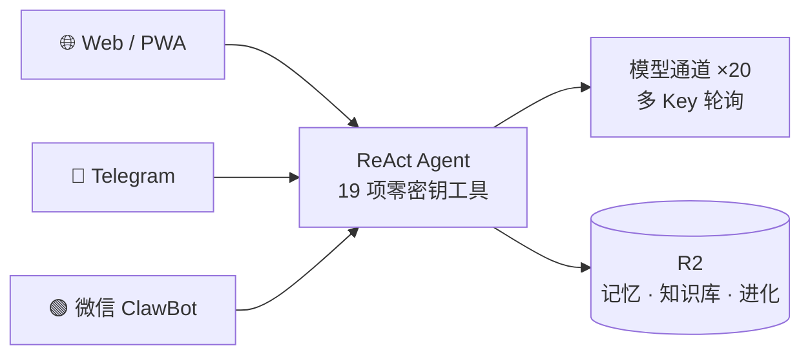

<div align="center">

# ⚡ Cloudflare-Chat `v7.45.0`

**一个 Worker，跑通 Web / Telegram / 微信三端 AI 对话**

[](https://deploy.workers.cloudflare.com/?url=https://github.com/jinhuaitao/cloudflare-chat)


零依赖 · 流式 SSE · PWA 离线 · R2 持久化 · 单 Worker 全栈

</div>

---

## 🧩 一句话架构



| 模块 | 能力 |
| :--- | :--- |
| 🌐 **三端** | Web/PWA 流式对话、Telegram 私聊群聊、微信 iLink 官方通道；共用同一 Agent 内核 |
| 🛠️ **Agent** | 搜索 / 抓取 / 百科 / GitHub / arXiv / 计算 / 汇率 / 天气 / 记忆 / 知识库，全部免额外 Key |
| 🧭 **专家人格** | 研究 / 编程 / 写作 / 分析 / 运维 / 教学 / 产品 / 审查 / 翻译 / 规划 / 设计 / 通用 |
| 🧠 **三层记忆** | 会话要点 → 长期事实 → 历史归档；单对象 CAS 原子写，冷读只需 1 次 GET |
| 📚 **知识库** | 写入模式、版本快照、指纹去重、标签检索；Web 只读，机器人可写 |
| 🧬 **自我进化** | 观测 → 提案 → 审批 → 灰度 → 回测 → 回滚；只动配置，不改代码 |

---

## 🧭 12 位专家人格

> 默认 `auto`：关键词 + 结构特征确定性打分（零额外往返）；`/agent <id>` 可固定。短追问自动承接，多阶段任务自动接力；网页端固定自动。

| 人格 | id | 擅长 | 工作方式 | 步数 / 上下文 |
| :--- | :--- | :--- | :--- | :---: |
| 🔬 研究员 | `research` | 调研核实 | 多源交叉、区分事实与推断 | 8 / 32K |
| 🧑‍💻 编程工程师 | `coder` | 写代码、排错 | 先定环境、查文档、定位根因 | 7 / 28K |
| ✍️ 写作编辑 | `writer` | 文案润色 | 定读者语气、去 AI 味 | 5 / 20K |
| 📊 数据分析师 | `analyst` | 指标报表 | 先对齐口径、计算走工具 | 6 / 26K |
| 🛠️ 运维排障 | `ops` | 故障定位 | 分层排查、修复可回滚 | 8 / 26K |
| 🎓 学习教练 | `tutor` | 概念讲解 | 直觉→例子→定义→自测 | 6 / 22K |
| 📋 产品经理 | `product` | PRD 需求 | 落到可验收的需求与边界 | 7 / 28K |
| 🧐 代码审查员 | `reviewer` | 审查风险 | 先找会出事的地方、结论分级 | 7 / 30K |
| 🌏 翻译与本地化 | `translator` | 互译校对 | 术语统一、逐段校对 | 5 / 24K |
| 🗓️ 项目规划师 | `planner` | 排期拆解 | 依赖排序、关键路径、风险预案 | 6 / 26K |
| 🎨 体验设计师 | `designer` | 界面交互 | 场景先行、状态完整、可解释 | 6 / 24K |
| 🤖 通用助手 | `general` | 闲聊常识 | 不限制工具，回落项 | 6 / 24K |

---

## 🚀 三步上线

1. **部署**：点上方按钮；或在 Cloudflare 控制台 → Workers & Pages → 连接 Git（构建留空，部署命令 `npx wrangler deploy`）。R2 与每分钟 Cron 已在 `wrangler.toml` 配好。
2. **配模型**：设置 `API_URL_1` · `API_KEY_1` · `MODEL_1=gpt-4o:GPT-4o`（最多 20 组通道；多 Key 逗号分隔，自动轮询与故障切流）。
3. **绑通道**（可选）：微信开启「设置 → 插件 → ClawBot」，网页左下角 🟢 扫码绑定；Telegram 配 `TG_BOT_TOKEN` + `TG_WEBHOOK_SECRET` 后访问：
   ```text
   https://api.telegram.org/bot<TOKEN>/setWebhook?url=https://<你的域名>/tg-webhook&secret_token=<SECRET>
   ```

> 🔒 公开部署请设置 `ACCESS_PASSWORD` 与 `WX_ADMIN_SECRET`：微信绑定需管理员密钥、一次绑定加锁、扫码人自动锁定。

## ⚙️ 常用变量

| 变量 | 作用 | 默认 |
| :--- | :--- | :--- |
| `ACCESS_PASSWORD` | Web 访问口令（`X-Access-Token`） | 免密 |
| `TG_BOT_TOKEN` / `TG_WEBHOOK_SECRET` | Telegram 机器人与 webhook 校验 | — |
| `WX_ADMIN_SECRET` | 微信绑定 / 解绑管理员密钥 | 回退 `ACCESS_PASSWORD` |
| `BRAVE_API_KEY` | 官方搜索 API（不填走零密钥多后端） | — |
| `AGENT_MAX_STEPS` / `AGENT_CONTEXT_BUDGET` | 覆盖人格默认预算 | 按人格 |
| `EVO_ENABLED` / `EVO_ADMIN_CHAT_ID` | 进化开关与审批管理员 | 开启 / 未配 |
| `RATE_LIMIT_PER_MIN` | 单 IP Web 请求限流 | 60 |

<details>
<summary>📖 完整配置与性能分析</summary>

- [README.full.md](README.full.md)：环境变量全表、三端指令、知识库链路、进化机制、已知限制
- [R2-PERFORMANCE.md](R2-PERFORMANCE.md)：存储瓶颈、CAS / 单飞 / 缓存优化与量化对比

</details>

## 🧪 本地开发

```bash
cp .dev.vars.example .dev.vars   # 本地密钥
npx wrangler dev                 # http://localhost:8787
npm run verify                   # 一致性检查 + 全量回归
npm test  # 578 个用例
npm run check                    # 版本号 / 语法 / 演示页 / 用例数
npm run build:tts-demo           # 重新生成 TTS 演示页
```

---

<div align="center">

MIT License · Powered by Cloudflare Workers + R2 ✨

</div>
